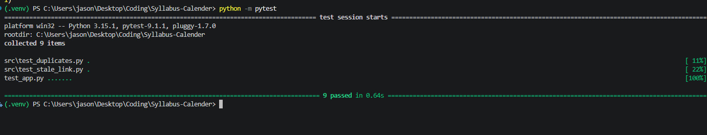
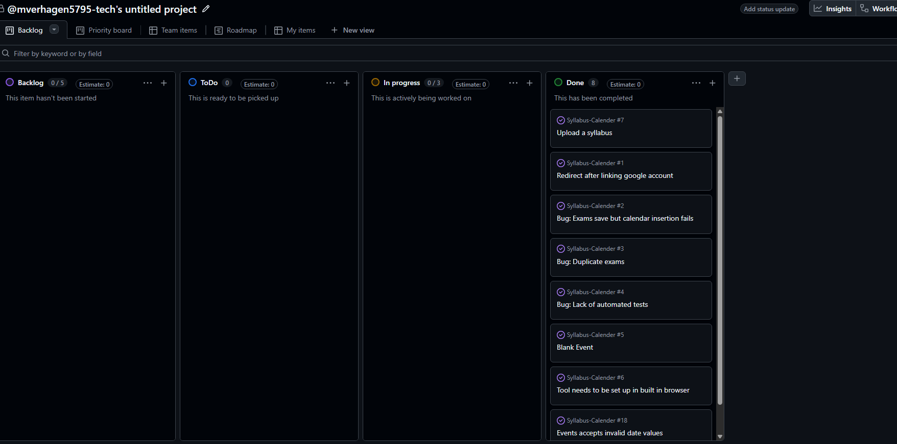

# PR4 Team Report

**Team 13 – Easy Aztecs**

**Team Members:**
- Tarran Thomas
- Finja Bruenen
- Matthew Verhagen
- Poulina Reipolska

## 1. Bug Triage Table

| Test name | Bucket | Issue link | Severity | Priority | Owner | Status |
|---|---|---|---|---|---|---|
| `test_duplicates.py` | Code bug | [Issue #3](https://github.com/mverhagen5795-tech/Syllabus-Calender/issues/3) | High | High | Poulina Reipolska | Fixed |
| `test_stale_link.py` | Code bug | [Issue #2](https://github.com/mverhagen5795-tech/Syllabus-Calender/issues/2) | Medium | High | Tarran Thomas | Fixed |
| `test_calendar_failure_provides_error_message` | Code bug | [Issue #2](https://github.com/mverhagen5795-tech/Syllabus-Calender/issues/2) | Medium | Medium | Tarran Thomas | Fixed |
| `test_whitespace_only_course_is_rejected` | Code bug | [Issue #17](INSERT-ISSUE-LINK) | Medium | Medium | Matthew Verhagen | Fixed |
| `test_invalid_date_is_rejected` | Code bug | [Issue #17](INSERT-ISSUE-LINK) | Medium | Medium | Matthew Verhagen | Fixed |

## 2. Regression Log

No regressions found.

Full test suite run on November 22, 2026: 9 passed, 0 failed.

## 3. Final Test Run

**Final result:** 9 passed, 0 failed.

No failing tests remain.

## 4. Feature Decision

**Feature name:** AI-Powered Syllabus Reading and Exam Entry.

**User story:** As a student, I want AI to read my uploaded course syllabus and automatically identify and enter important dates, exams, and assignments, so that I don't have to manually enter everything myself.

**Why we chose it:** We chose this feature because manually entering exam dates and assignments can be time-consuming. Using AI to read syllabi and identify important information would make SyllabusFlow easier to use, save students time, and reduce the chance of missing important deadlines.

**Owners:**
- Tarran Thomas: Backend integration of the AI service and processing extracted syllabus information.
- Finja Bruenen: AI extraction of exam dates, assignment deadlines, and other important course information.
- Matthew Verhagen: Frontend implementation for uploading syllabi and displaying the extracted information.
- Poulina Reipolska: Testing AI extraction accuracy, validating extracted dates, and handling incorrect or missing information.

**Test cases:**
1. Upload a syllabus containing exam dates and verify that the AI correctly identifies the exam names and dates.
2. Upload a syllabus with multiple assignments and deadlines and verify that the extracted information is correctly entered into the application.

## 5. Board Snapshot

## 6. Sprint Summary

Our team fixed bugs involving duplicate exam submissions, stale Google Calendar event links, missing calendar failure messages, whitespace-only input, and invalid dates. The final local test suite passed all 9 tests with no failures. No known failing tests remain. The next sprint should focus on completing and testing the selected Google Calendar authorization improvement, reviewing remaining edge cases, and checking that the application works correctly from the user's perspective.