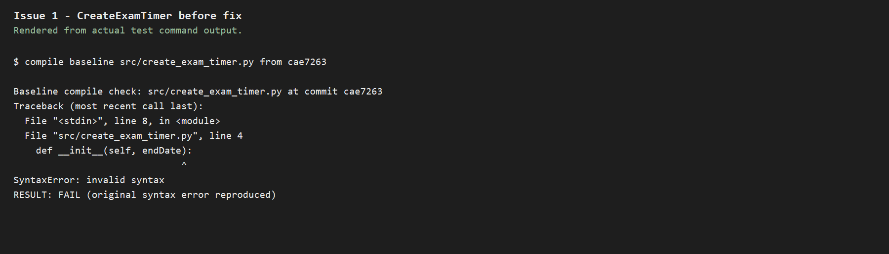
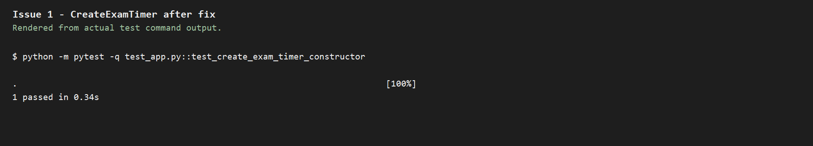
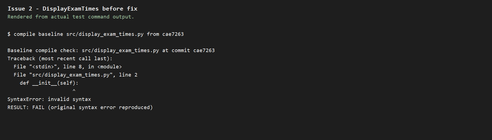
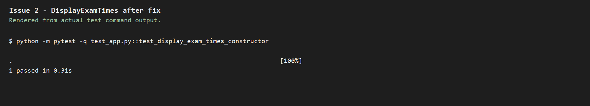

# Finja Bruenen

## Bug 1: CreateExamTimer constructor syntax

- **Issue:** Not filed; kept local as requested.
- **PR:** Not created as requested.
- **Before:** 
- **After:** 
- **Classification:** Code bug. The original `def__init__` declaration caused a `SyntaxError`; the corrected constructor imports and its focused test passes.

## Bug 2: DisplayExamTimes constructor syntax

- **Issue:** Not filed; kept local as requested.
- **PR:** Not created as requested.
- **Before:** 
- **After:** 
- **Classification:** Code bug. The original `def__init__` declaration caused a `SyntaxError`; the corrected constructor imports and its focused test passes.

**Evidence note:** The PNGs are terminal-style renderings of the actual before/after command output, not raw desktop captures.

**AI disclosure:** Copilot assisted in identifying and fixing both syntax errors and in adding focused regression tests.
