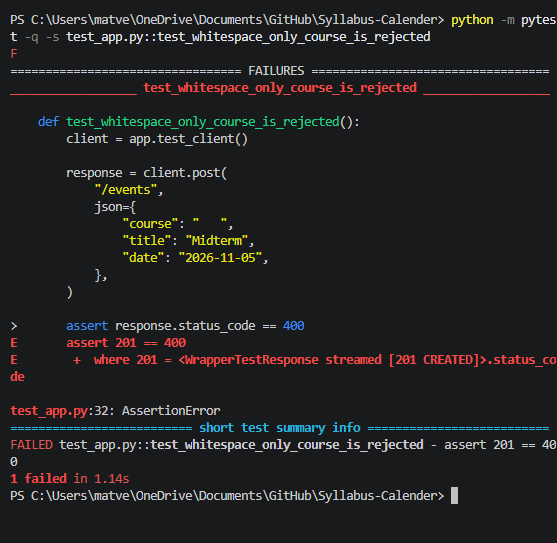
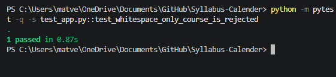
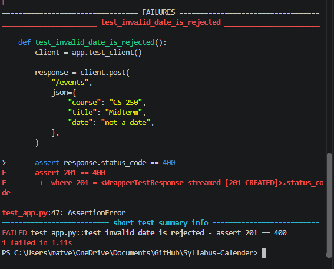
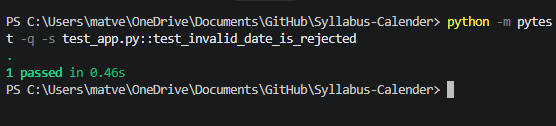

# Matthew Verhagen

## Issue 1: Whitespace only required fields are accepted

- Issue link: [Issue #17](https://github.com/mverhagen5795-tech/Syllabus-Calender/issues/17)
- PR link: [Pull Request #NUMBER](https://github.com/mverhagen5795-tech/Syllabus-Calender/pull/19)

### Before

### After

This was a code bug because the test correctly expected HTTP 400, but the application returned HTTP 201 before the fix.

## Issue 2: Invalid dates are accepted

- Issue link: [Issue #NUMBER](https://github.com/mverhagen5795-tech/Syllabus-Calender/issues/18)
- PR link: [Pull Request #NUMBER](https://github.com/mverhagen5795-tech/Syllabus-Calender/pull/19)

### Before

### After

This was a code bug because the test correctly expected HTTP 400 for an invalid date, but the application returned HTTP 201 before the fix.

## AI Disclosure

I used ChatGPT to explain the test failures and review the updated tests. I ran the tests and verified the results myself.