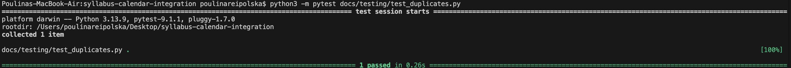
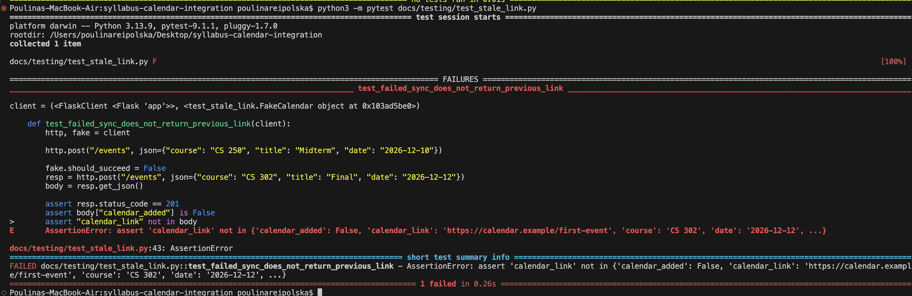
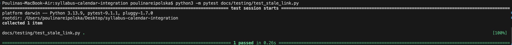

# Poulina Reipolska

## Bug 1: Duplicate exams create duplicate Google Calendar events
- Issue: <link to Issue #N>
- PR: [<link to PR>](https://github.com/mverhagen5795-tech/Syllabus-Calender/issues/3)

**Before:**

**After:**

**Bucket:** Code bug. The test submits the same exam twice and correctly expects a 409 on the second, but the code returned 201 and saved a duplicate, so the code was wrong and the test was right.

**AI disclosure:** 

## Bug 2: Failed calendar sync returns the previous event's link
- Issue: <link to Issue #N>
- PR: [<link to PR>](https://github.com/mverhagen5795-tech/Syllabus-Calender/issues/2)

**Before:**

**After:**

**Bucket:** Code bug. The test expects no `calendar_link` when `calendar_added` is false, which is correct, but the code returned the previous exam's link.

**AI disclosure:** 
