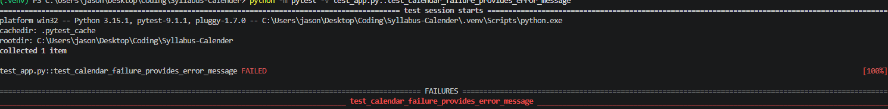
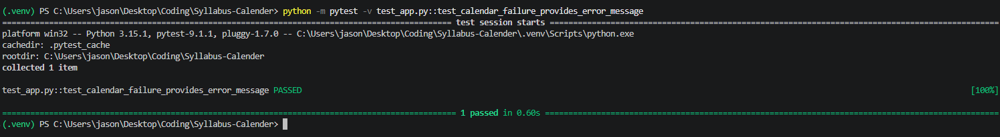
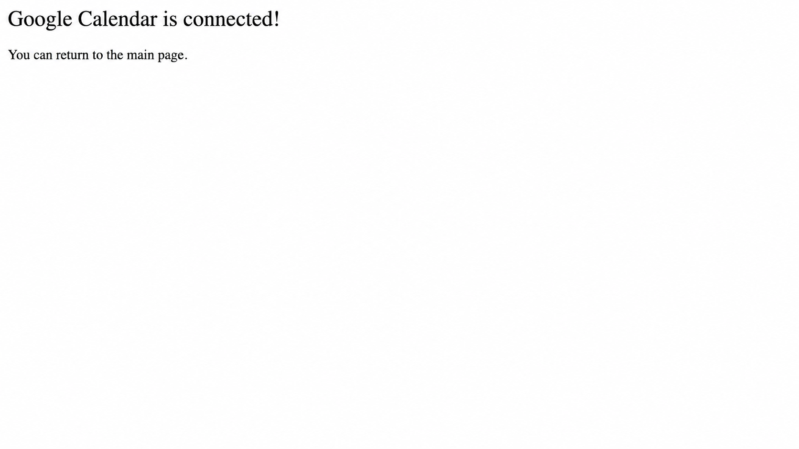
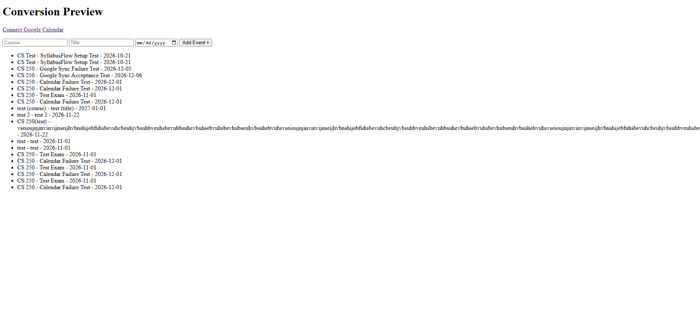

# Tarran Thomas

## Bug 1: Google Calendar sync failure does not provide an error message
- Issue: https://github.com/mverhagen5795-tech/Syllabus-Calender/issues/2
- PR: (https://github.com/mverhagen5795-tech/Syllabus-Calender/pull/22)

**Before:**

**After:**

**Bucket:** Code bug. When adding an exam to Google Calendar failed, the application returned `calendar_added: false` without explaining why the event could not be added. The code was changed to provide an error message so the user knows that the calendar insertion failed.

**AI disclosure:** Used chatgpt to check for any mistakes i made

## Bug 2: User is not automatically redirected after Google Calendar authorization
- Issue: https://github.com/mverhagen5795-tech/Syllabus-Calender/issues/1
- PR: https://github.com/mverhagen5795-tech/Syllabus-Calender/pull/22

**Before:**

**After:**

**Bucket:** Code bug / feature improvement. After successfully authorizing Google Calendar, the application did not automatically return the user to the main page. The code was changed to redirect the user to the home page after authorization.

**AI disclosure:** Used chatgpt to check if I made mistakes
